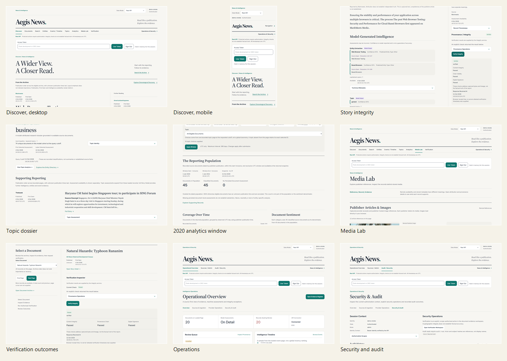

# Local demo acceptance

Acceptance was run on Windows, 11 October 2026, against the local `aegis-demo`
Compose project. The branch is `feat/aegis-local-demo-launcher`. The commit that
introduces this report is the implementation commit on that branch. No merge,
push, or deployment was performed.

## Commands

| Action | Command |
| --- | --- |
| First-time startup | `python scripts/demo.py start --build` |
| Ordinary restart | `python scripts/demo.py start` |
| Status | `python scripts/demo.py status` |
| Doctor | `python scripts/demo.py doctor` |
| Browser journey | `python scripts/demo.py smoke` |
| Shutdown, data kept | `python scripts/demo.py stop` |

`start --build` was used for the first image build. Later restarts reused the
volumes. The web image was rebuilt once more so the running frontend includes
the Real API failure copy, without removing volumes.

## URLs

| Service | URL | Verified |
| --- | --- | --- |
| Web | http://127.0.0.1:33000 | HTTP ready, Real API mode |
| API | http://127.0.0.1:38000 | `/ready` passed |
| API docs | http://127.0.0.1:38000/docs | Mapped |
| Temporal | http://127.0.0.1:38233 | API dependency ready |
| MinIO console | http://127.0.0.1:39001 | Live |
| Prometheus | http://127.0.0.1:39090 | `/-/ready` |
| Grafana | http://127.0.0.1:33001/d/aegis-demo | HTTP health passed |
| Loki | http://127.0.0.1:33100 | `/ready` |
| Collector | http://127.0.0.1:34318 | Unverified; GET is not a health check |

## Services

`python scripts/demo.py status` after the final web recreate:

| Service | State |
| --- | --- |
| postgres, redis, minio, temporal, api, web | healthy |
| worker, prometheus, grafana, loki, alloy, otel-collector | running |
| keys-init, minio-init, migrate | exited 0 |
| Required readiness | yes |

`doctor` reported Python 3.13.5, Docker context `desktop-linux` on the local
named pipe, CORS limited to the local frontend origins, ports owned by this
project, and seed verification passed with 14 topics. `otel-http` stayed
unverified.

## Doppler

Project visible to the authenticated CLI: `aegis-news`. Configurations: `dev`,
`dev_personal`, `stg`, `prd`. Launcher result: ambiguous, so no provider
variables were injected. Secret values were not printed, saved, or committed.
Staging and production names are rejected. Startup did not call a paid provider.
Provider acquisition remains `python scripts/demo.py acquire` and was not run.

## Demo data

The seed is idempotent and did not reset the existing volume.

| Set | Result |
| --- | --- |
| CC0 showcase demo v1 | 24 documents, created through Temporal |
| Showcase publication dates | 23 dated, 1 unknown |
| Showcase media flag | 1 original reference |
| Intended topic labels | 14 labels in `data/samples/showcase.json` |
| CC0 presentation demo v1 | 12 documents already on this volume |
| Sources on the volume | 45 |
| Second start | no additional showcase documents |

A new showcase workflow failed once because the worker rejected a future
`first_seen_at` when the Temporal clock was ahead. The check was left unchanged.
The next `start` completed the ingestion. HTTP acceptance was not treated as
completion: the seed waits on the workflow status. A repeated submission reused
the same workflow id.

Analyses on the volume, including the pre-existing corpus: sentiment 3117,
topic 3117, embedding 3117, entity extraction 2062, entity resolution 2062,
event extraction 150. Those figures are larger than the 24 showcase articles
because this database already held a historical corpus. The launcher does not
delete that data.

## Real API acceptance

| Experience | Result |
| --- | --- |
| Discover | Confirmed. Real API mode, authenticated session, source-backed articles with publication and first-seen times. |
| Chronological Discovery | Page opened. API pages of 20 and 20 were ordered and disjoint. |
| Documents | Document Archive opened against the live API. |
| Search | "Atlas" returned the synthetic title "Atlas Labs reports growth and merger" on multiple stored copies. |
| Story Detail | Model-generated entity and topic assessments rendered beside source text. Integrity result was Verified, not Simulated. |
| Entities | Entity Directory opened. |
| Events | Events / Timeline opened. Publication time and first-seen time stay separate on the story and topic pages. |
| Topic Directory | A `topic_v1_` dossier opened from the directory. |
| Topic Detail | `business`, model `local-baseline` / `keyword-topics` / `1`, 74 unique documents, supporting articles with source excerpts. |
| Intelligence Analytics | Publication window 2020-01-01T00:00:00Z inclusive through 2021-01-01T00:00:00Z exclusive: population 45, classified 45, 3003 unknown publication times excluded. Browser matched the API. |
| Media Lab | The bounded page showed article and image references, including 12 article references, and stated the video-reference result for that response. |
| Verification | Content integrity, provenance chain, and digital signature each returned Passed. The UI says this does not establish factual truth. |
| Operations | Loaded page count 20, API connected, review queue visible. |
| Sources and ingestion | Registry rendered real source rows. Showcase creation and document submission completed through the API and worker. The registry is ordered by source id, so the newest showcase name is not guaranteed on the first page. |
| Security and audit | Session subject `demo-smoke`, role admin, bearer identity verified by the API, audit history visible. |

An as-of cutoff of 2019 returned an empty topic result (`historical_cutoff_empty`
true). Migration head is `live_providers_0001`.

## Authentication

Development tokens remain in memory, expire after five minutes, and are not
written to `localStorage`, URLs, logs, or browser traces. The smoke test set the
token with a DOM property and cleared the field. Screenshots show the empty
token field and the subject `demo-smoke`.

| Probe | HTTP |
| --- | --- |
| Unauthenticated read | 401 |
| Expired token | 401 |
| Viewer read | 200 |
| Viewer source create | 403 |
| Analyst source create | 403 |
| Analyst identity | 200 |

## Verification

API verification of `doc_002a64b2-e055-4020-bd85-f7eeaf204596` returned valid.
In the browser, story integrity returned Verified, and the verification
workspace returned Passed for content integrity, provenance chain, and digital
signature on "Natural Hazards: Typhoon Rananim". The controlled tamper-and-restore
command was not run against this shared volume.

## Browser journey

`python scripts/demo.py smoke` passed against the rebuilt production Next.js
container on http://127.0.0.1:33000. Playwright did not mock the network, and
trace, video, and failure screenshots were off. The journey authenticated, then
opened Discover, a story, Topics, a topic dossier, Analytics with the 2020
publication window, Media Lab, Verification, chronological discovery, Documents,
Search, Entities, Events, Operations, Sources, and Security. No page errors were
recorded.

Desktop and mobile evidence:

Individual frames are in `docs/local-demo-evidence/`.

## Tests

| Suite | Result |
| --- | --- |
| `uv run ruff check` on the launcher modules | passed |
| `uv run mypy` on `scripts/demo.py`, `scripts/demo_support.py`, `scripts/demo_seed.py` | passed |
| `uv run pytest tests/unit/test_demo_launcher.py` | 11 passed |
| `uv run pytest tests/unit` | 217 passed, 1 skipped |
| `pnpm --filter @aegisnews/web test` | 15 files, 69 tests passed |
| Playwright `e2e/demo-smoke.spec.ts` | passed on the final web image |

Pytest printed a Windows cache-permission warning. The tests still passed.

## Confirmed

Real API is the demo default. Mock data remains an explicit Data Mode switch.
Failures in Real API mode are not replaced with mock records. The secured API,
worker, database, object storage, and Temporal dependency were ready. Showcase
ingestion, topic membership, the 2020 analytics window, scope checks, and
cryptographic verification returned real results.

## Tested but limited

The analytics population of 45 and the large analysis counts include the
pre-existing historical corpus, not only the 24 showcase articles. Media Lab
shows whatever the current bounded page contains, including publisher references
already stored on this volume. The source registry browser check confirmed rows,
not a specific source name, because pages are ordered by source id. Event
extraction covers 150 analyses, far fewer than the document analyses, so some
records have no extracted event. The OpenTelemetry collector has no trace UI.

## Unavailable optional providers

No NewsData, GNews, NewsAPI, or YouTube credential was injected. No provider
acquisition ran. GDELT was not called. Where the showcase is the new content, it
is labeled original synthetic demonstration text.

## Deferred

Production login, permanent admin tokens, and cloud deployment were not added.
The controlled security demonstration was not executed on this volume. The
five-minute development-token lifetime was left as it is.

## Untested on this host

macOS and Linux were not executed here. The launcher unit test checks that the
Windows-only subprocess creation flag is absent on other platforms. Grafana
dashboard panels were not clicked; only the Grafana health endpoint was checked.
The Temporal web UI was not clicked; workflow completion was checked through the
ingestion-run API.
